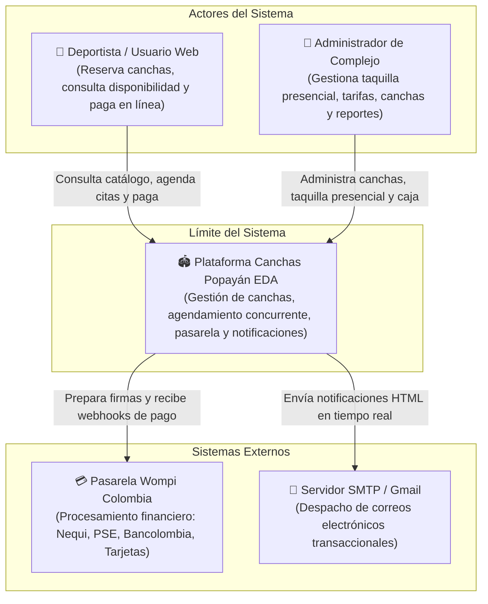
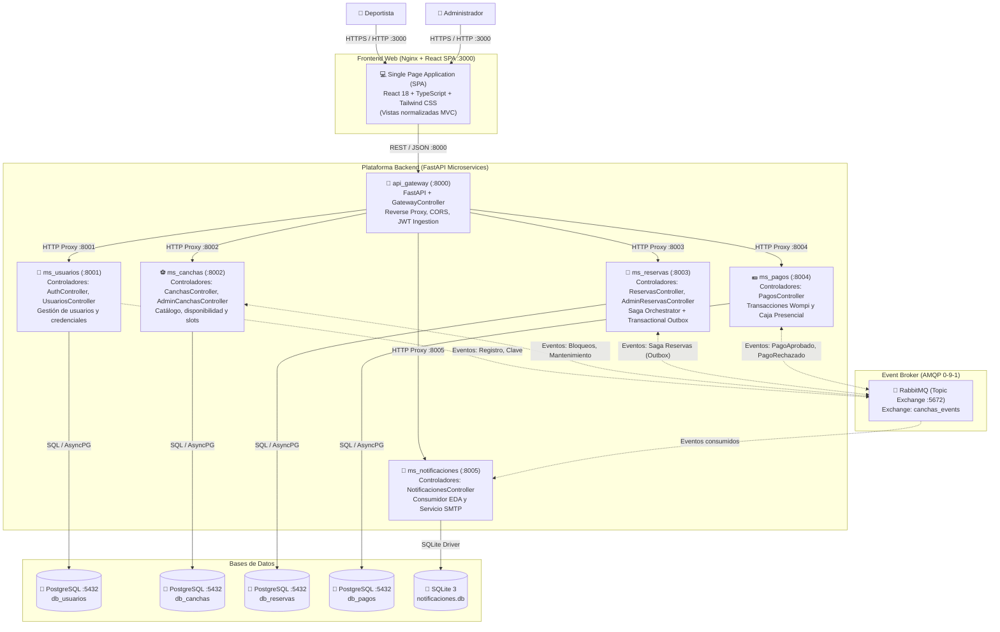
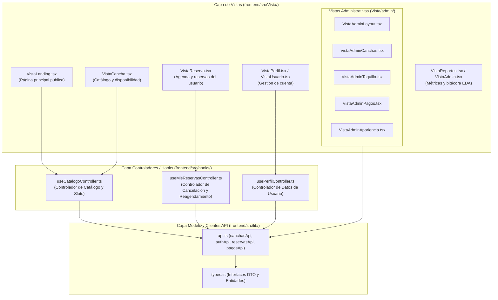
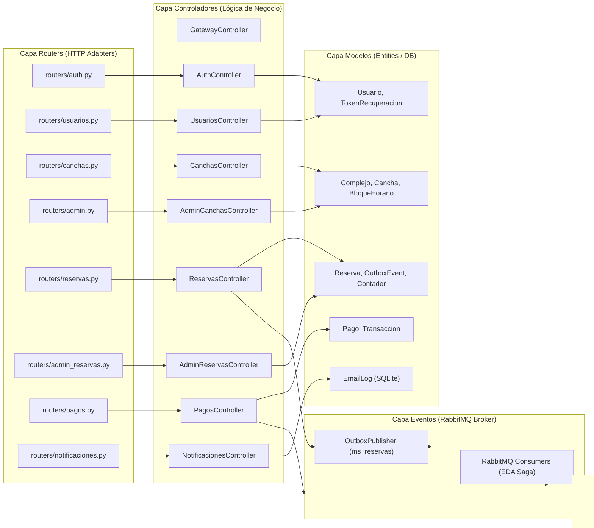

# 📐 Modelo C4 — Plataforma de Gestión y Reserva de Canchas Popayán
### Proyecto de Tesis: Arquitectura Dirigida por Eventos (EDA) + CQRS + Patrón Saga + MVC

Este documento describe la arquitectura técnica de la plataforma bajo el estándar **Modelo C4** (Contexto, Contenedores, Componentes y Código), incorporando la refactorización arquitectónica **Modelo-Vista-Controlador (MVC)** implementada en el backend y el frontend.

---

## 🧭 Nivel 1: Diagrama de Contexto del Sistema (System Context)

El diagrama de contexto describe los actores que interactúan con la plataforma y los sistemas externos integrados.

---

## 📦 Nivel 2: Diagrama de Contenedores (Container Diagram)

Muestra los contenedores lógicos que conforman la solución, sus responsabilidades de alto nivel y protocolos de comunicación.

---

## 🧩 Nivel 3: Diagrama de Componentes (Component Diagram)

Detalla la organización interna bajo el patrón **Modelo-Vista-Controlador (MVC)** tanto en el frontend como en los microservicios del backend.

### 3.1. Componentes del Frontend (Vistas y Controladores)

---

### 3.2. Componentes del Backend (Estructura MVC de Microservicios)

Cada microservicio desacopla estrictamente los enrutadores HTTP, los controladores de lógica de negocio, los modelos de base de datos y la mensajería asíncrona:

---

## 🔍 Nivel 4: Diagrama de Código (Class & Code Level)

### Mapeo de Controladores Backend y Responsabilidades

| Microservicio | Controlador | Archivo | Responsabilidad Principal |
|---|---|---|---|
| **api_gateway** | `GatewayController` | `Controladores/api_gateway/app/gateway_controller.py` | Reverse proxy asíncrono, clasificación de rutas públicas/admin, decodificación JWT e inyección de encabezados de contexto. |
| **ms_usuarios** | `AuthController` | `Controladores/ms_usuarios/app/auth_controller.py` | Registro de usuarios/administradores, emisión de JWT, recuperación y cambio de contraseñas. |
| **ms_usuarios** | `UsuariosController` | `Controladores/ms_usuarios/app/usuarios_controller.py` | Consulta de perfil propio, actualización de datos personales y auditoría. |
| **ms_canchas** | `CanchasController` | `Controladores/ms_canchas/app/canchas_controller.py` | Consulta pública de complejos, cálculo dinámico de bloques horarios y disponibilidad. |
| **ms_canchas** | `AdminCanchasController` | `Controladores/ms_canchas/app/admin_controller.py` | Administración de complejos, creación/edición de canchas, bloqueos por mantenimiento y carga de banners. |
| **ms_reservas** | `ReservasController` | `Controladores/ms_reservas/app/reservas_controller.py` | Solicitud de reservas con bloqueo pesimista en PostgreSQL, cancelación, reprogramación y escritura en tabla Outbox. |
| **ms_reservas** | `AdminReservasController` | `Controladores/ms_reservas/app/admin_reservas_controller.py` | Taquilla presencial, gestión de agenda integral por complejo y confirmación en sitio. |
| **ms_pagos** | `PagosController` | `Controladores/ms_pagos/app/pagos_controller.py` | Integración Wompi Colombia (firma de integridad HMAC SHA-256), recepción de webhooks, pago presencial y eventos Saga. |
| **ms_notificaciones** | `NotificacionesController` | `Controladores/ms_notificaciones/app/notificaciones_controller.py` | Consulta de bitácora de correos despachados, filtrado por eventType y estadísticas de despacho. |

---

### Mapeo de Vistas Frontend Normalizadas

| Vista Normalizada | Ruta URL | Archivo | Propósito en la Experiencia de Usuario |
|---|---|---|---|
| `VistaLanding` | `/` | `Vista/src/VistaLanding.tsx` | Pantalla de inicio pública, presentación de complejos y acceso rápido. |
| `VistaCancha` | `/catalogo` | `Vista/src/VistaCancha.tsx` | Catálogo de complejos, selección de fecha/hora y grilla interactiva de canchas sintéticas. |
| `VistaReserva` | `/mis-reservas` | `Vista/src/VistaReserva.tsx` | Historial de reservas del usuario con opciones de reprogramación o cancelación. |
| `VistaPerfil` | `/perfil` | `Vista/src/VistaPerfil.tsx` | Consulta y actualización de datos de perfil y cambio de credenciales de acceso. |
| `VistaReportes` | `/reportes`, `/monitor` | `Vista/src/VistaReportes.tsx` | Consola en tiempo real de eventos EDA y auditoría técnica de notificaciones. |
| `VistaLogin` | `/login` | `Vista/src/VistaLogin.tsx` | Formulario de autenticación con split-screen responsivo y persistencia de sesión JWT. |
| `VistaRegistro` | `/registro` | `Vista/src/VistaRegistro.tsx` | Creación de cuenta con pestañas independientes para deportistas y administradores. |
| `VistaRecuperarPassword` | `/recuperar-password` | `Vista/src/VistaRecuperarPassword.tsx` | Solicitud de enlace de restablecimiento e ingreso de nueva contraseña mediante token. |
| `VistaAdminLayout` | `/admin` | `Vista/src/admin/VistaAdminLayout.tsx` | Contenedor principal con barra de navegación lateral para el portal del administrador. |
| `VistaAdminCanchas` | `/admin/canchas` | `Vista/src/admin/VistaAdminCanchas.tsx` | Panel de gestión de canchas, tarifas por hora y bloqueos por mantenimiento. |
| `VistaAdminTaquilla` | `/admin/taquilla` | `Vista/src/admin/VistaAdminTaquilla.tsx` | Taquilla presencial, búsqueda de reservas por cliente y agenda diaria del complejo. |
| `VistaAdminPagos` | `/admin/pagos` | `Vista/src/admin/VistaAdminPagos.tsx` | Conciliación de ingresos, registro de pagos en efectivo/transferencia y reportes. |
| `VistaAdminApariencia` | `/admin/apariencia` | `Vista/src/admin/VistaAdminApariencia.tsx` | Personalización visual, fondos de pantalla y banners de los complejos deportivos. |

---

## 🛡️ Principios Arquitectónicos Garantizados

1. **Separación de Responsabilidades (SoC):** Cada capa (Router -> Controlador -> Modelo -> Broker) posee una única razón de cambio.
2. **Arquitectura Dirigida por Eventos (EDA):** Comunicación asíncrona mediante RabbitMQ Topic Exchange evitando acoplamiento temporal entre microservicios.
3. **Patrón Saga Coreografiado:** Orquestación de reserva y pago con compensación automática (rollback) si el pago es rechazado o cancelado.
4. **Patrón Transactional Outbox:** Garantía de entrega a nivel de persistencia de base de datos antes de despachar eventos al broker.
5. **Control de Concurrencia Estricto:** Bloqueos advisory/pessimistic en PostgreSQL para evitar sobre-venta de franjas horarias en partidos simultáneos.
